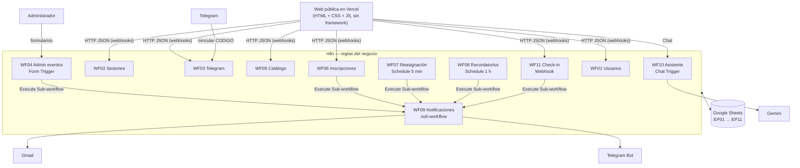
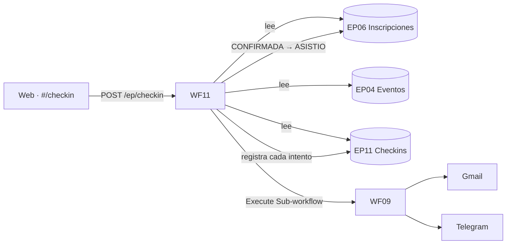

# EventPass · Agenda deportiva

**Estudiante:** Mariangel Jaimes ([@Mariangel106](https://github.com/Mariangel106))
**URL pública (Vercel):** https://eventpass-santander.vercel.app
**Repositorio:** https://github.com/Mariangel106/Evenpass

EventPass es una aplicación web pública para inscribirse a eventos deportivos en Santander (Colombia). Hay cinco disciplinas: natación, atletismo, ciclismo, karate y CrossFit. Cada una tiene un evento para **adultos** y otro para **niños**, todos con **10 cupos**.

La web es solo un cliente. **Toda la lógica de negocio vive en n8n**: validaciones, cupos, lista de espera, sesiones, idempotencia, notificaciones y persistencia en Google Sheets. La web **nunca** se conecta a Google Sheets.

---

## Contenido

1. [Qué puede hacer el usuario](#1-qué-puede-hacer-el-usuario)
2. [Arquitectura](#2-arquitectura)
3. [Tecnologías](#3-tecnologías)
4. [Workflows, triggers y Google Sheets](#4-workflows-triggers-y-google-sheets)
5. [Comunicación frontend → n8n](#5-comunicación-frontend--n8n)
6. [Endpoints](#6-endpoints)
7. [Estados](#7-estados)
8. [Hashing de contraseñas](#8-hashing-de-contraseñas)
9. [Sesiones](#9-sesiones)
10. [Idempotencia](#10-idempotencia)
11. [Lista de espera y reasignación](#11-lista-de-espera-y-reasignación)
12. [Servicio central de notificaciones](#12-servicio-central-de-notificaciones)
13. [Asistente IA y sus restricciones](#13-asistente-ia-y-sus-restricciones)
14. [Datos de prueba](#14-datos-de-prueba)
15. [Variables de entorno](#15-variables-de-entorno)
16. [Cómo ejecutar el proyecto](#16-cómo-ejecutar-el-proyecto)
17. [Estructura del repositorio](#17-estructura-del-repositorio)
18. [Seguridad](#18-seguridad)
19. [Examen — Check-in digital](#19-examen--check-in-digital)

---

## 1. Qué puede hacer el usuario

| Público (sin cuenta) | Usuario registrado | Administrador (en n8n) |
|---|---|---|
| Ver la agenda y los cupos en vivo | Crear cuenta, iniciar y cerrar sesión | Crear, consultar y actualizar eventos |
| Filtrar por disciplina y grupo de edad | Ver y editar su perfil, cambiar contraseña | Publicar, cerrar o cancelar eventos |
| Ver el detalle de un evento | Vincular su Telegram con un código | — |
| Registrar el ingreso de un asistente (*Check-in*) | Ver su código de ingreso en *Mis inscripciones* | — |
| Hablar con el asistente | Inscribirse, editar o cancelar inscripciones | — |
| | Recibir avisos por Gmail **y** Telegram | — |
| | Desactivar su cuenta | — |

La interfaz maneja tres estados en todas las vistas: **cargando** (texto y dorsales de carga), **éxito** (avisos y confirmaciones en línea) y **error** (mensaje claro y botón *Intentar de nuevo*).

La idea visual es el **dorsal de competencia**: cada evento es un dorsal y el número grande son los **cupos libres**, calculados por n8n.

## 2. Arquitectura



Principio que respeta todo el proyecto:

```
Aplicación pública en Vercel
        ↓ HTTP / Chat
       n8n
        ↓
Reglas del negocio
        ↓
Google Sheets
        ↓
Gmail / Telegram / IA
```

- **Frontend**: solo pinta datos y envía solicitudes. No calcula cupos ni decide estados.
- **n8n**: valida, decide, persiste, controla la idempotencia, cambia estados, integra servicios y notifica.
- **Google Sheets**: persistencia académica. Hay un archivo por workflow principal; ver [docs/google-sheets.md](docs/google-sheets.md).

## 3. Tecnologías

| Capa | Tecnología |
|---|---|
| Frontend | HTML5, CSS3 y JavaScript (módulos ES) sin build ni dependencias |
| Tipografía | Big Shoulders Display (títulos y números de dorsal) y Public Sans (texto), de Google Fonts |
| Hosting | Vercel, sitio estático con un build que genera `config.js` desde variables de entorno |
| Automatización | n8n: Webhook, Form Trigger, Telegram Trigger, Schedule Trigger, Execute Sub-workflow Trigger, Chat Trigger, Code, IF, Switch, Filter, Aggregate, Sort, Merge, Google Sheets, Gmail, Telegram, AI Agent |
| Persistencia | Google Sheets (11 archivos) |
| Mensajería | Gmail y bot de Telegram |
| IA | Google Gemini (`gemini-3.1-flash-lite`) con un AI Agent de n8n y memoria por conversación |
| Diseño asistido | Claude Code con la skill *frontend-design* |

## 4. Workflows, triggers y Google Sheets

| Workflow | Archivo JSON | Trigger | Archivo de Sheets (escritura) | Lee además |
|---|---|---|---|---|
| WF01 — Usuarios CRUD | `n8n/WF01_usuarios_crud.json` | Webhook `POST /ep/usuarios` | **EP01_Usuarios** (Usuarios, Auditoria_Usuarios) | EP02, EP03 |
| WF02 — Autenticación y sesiones | `n8n/WF02_auth_sesiones.json` | Webhook `POST /ep/auth` | **EP02_Sesiones** (Sesiones) | EP01 |
| WF03 — Vinculación con Telegram | `n8n/WF03_vinculacion_telegram.json` | Webhook `POST /ep/telegram/codigo` + **Telegram Trigger** | **EP03_Telegram** (Codigos_Vinculacion, Vinculaciones) | EP01, EP02 |
| WF04 — Administración de eventos | `n8n/WF04_eventos_crud.json` | **4 n8n Form Trigger** con Basic Auth | **EP04_Eventos** (Eventos, Auditoria_Eventos) | EP06 |
| WF05 — Catálogo público | `n8n/WF05_catalogo_publico.json` | Webhook `GET /ep/catalogo` | **EP05_Catalogo_Log** (Consultas_Catalogo) | EP04, EP06 |
| WF06 — Inscripciones CRUD | `n8n/WF06_inscripciones_crud.json` | Webhook `POST /ep/inscripciones` | **EP06_Inscripciones** (Inscripciones, Auditoria_Inscripciones) | EP01, EP02, EP03, EP04 |
| WF07 — Reasignación de lista de espera | `n8n/WF07_reasignacion_lista_espera.json` | **Schedule** cada 5 minutos | **EP07_Reasignaciones** (+ actualiza el estado en EP06) | EP04, EP06 |
| WF08 — Recordatorios | `n8n/WF08_recordatorios.json` | **Schedule** cada hora | **EP08_Recordatorios** | EP01, EP04, EP06 |
| WF09 — Notificaciones | `n8n/WF09_notificaciones.json` | **Execute Sub-workflow Trigger** | **EP09_Notificaciones** | EP01, EP03 |
| WF10 — EventPass Assistant | `n8n/WF10_eventpass_assistant.json` | **Chat Trigger** | **EP10_Soporte** (Conversaciones, Mensajes) | EP04, EP06 (solo lectura) |
| WF11 — Check-in digital | `n8n/WF11_checkin_digital.json` | Webhook `POST /ep/checkin` | **EP11_Checkin** (Checkins) (+ actualiza el estado en EP06) | EP04, EP06 |

Cada workflow tiene una nota adhesiva en el lienzo con su responsabilidad, y nodos con nombres que dicen lo que hacen: *Control email duplicado*, *Generar hash, salt y usuario_id*, *Validar expiración*, *Calcular cupos*, *Ordenar lista de espera*, etc.

**WF07, WF11 y la hoja de inscripciones.** Al promover a alguien (WF07) o registrar su ingreso (WF11), se actualiza el `estado` en EP06 porque esa es la fuente de verdad de las inscripciones. Su propio registro va en su archivo: la reasignación en EP07 y el check-in en EP11.

## 5. Comunicación frontend → n8n

1. La web lee `window.EVENTPASS_CONFIG` (de `public/js/config.js`), que Vercel genera en cada build desde las variables de entorno.
2. Todas las llamadas pasan por [`public/js/api.js`](public/js/api.js): `fetch` con JSON, tiempo máximo de 25 s y mensajes de error legibles.
3. Los webhooks usan `Respond to Webhook`, así n8n responde con un **código HTTP real** (200, 201, 400, 401, 403, 404, 409) y un cuerpo `{ ok, ... }` o `{ ok: false, error }`.
4. CORS: cada Webhook tiene `Allowed Origins = *` (en producción se puede restringir al dominio de Vercel).
5. Si n8n responde 401 o 403 por la sesión, la web borra la sesión local y pide ingresar de nuevo.
6. El asistente usa el **Chat Trigger** de WF10 en modo embebido. La web envía `{ action: "sendMessage", sessionId, chatInput, metadata }`.

## 6. Endpoints

Base: `EP_N8N_BASE_URL`, por ejemplo `https://tu-instancia.app.n8n.cloud/webhook`. Hay ejemplos completos de solicitud y respuesta en [docs/endpoints.md](docs/endpoints.md).

| Método | Ruta | `accion` / parámetros | Workflow | Respuestas |
|---|---|---|---|---|
| POST | `/ep/usuarios` | `crear` (nombre, email, password) | WF01 | 201, 400, 409 |
| POST | `/ep/usuarios` | `perfil` (session_token) | WF01 | 200, 401, 403 |
| POST | `/ep/usuarios` | `actualizar` (session_token, nombre, password_actual, password_nueva) | WF01 | 200, 400, 401 |
| POST | `/ep/usuarios` | `desactivar` (session_token, password) | WF01 | 200, 400, 401 |
| POST | `/ep/auth` | `login` (email, password) | WF02 | 200, 401, 403 |
| POST | `/ep/auth` | `logout` (session_token) | WF02 | 200, 404, 409 |
| POST | `/ep/auth` | `validar` (session_token) | WF02 | 200, 401, 403 |
| POST | `/ep/telegram/codigo` | session_token | WF03 | 201, 401 |
| GET | `/ep/catalogo` | `tipo=LISTADO` | WF05 | 200 |
| GET | `/ep/catalogo` | `tipo=DETALLE&evento_id=…` | WF05 | 200, 404 |
| GET | `/ep/catalogo` | `tipo=FILTRO&categoria=…&grupo_edad=…` | WF05 | 200, 400 |
| POST | `/ep/inscripciones` | `crear` (session_token, evento_id, nombre_acreditacion, observaciones) | WF06 | 201, 404, 409 |
| POST | `/ep/inscripciones` | `listar` (session_token) | WF06 | 200, 401 |
| POST | `/ep/inscripciones` | `actualizar` (session_token, inscripcion_id, nombre_acreditacion, observaciones) | WF06 | 200, 400, 404, 409 |
| POST | `/ep/inscripciones` | `cancelar` (session_token, inscripcion_id) | WF06 | 200, 404, 409 |
| POST | `/ep/checkin` | inscripcion_id, evento_id | WF11 | 201, 400, 404, 409 |
| POST | URL del Chat Trigger | `action=sendMessage`, sessionId, chatInput | WF10 | 200 |

Además del webhook, en el catálogo se puede enviar `visitor_id` (identificador anónimo del navegador) para el log de consultas.

## 7. Estados

| Entidad | Estados | Dónde |
|---|---|---|
| Usuario | `ACTIVO` · `INACTIVO` | EP01 / Usuarios |
| Sesión | `ACTIVA` · `CERRADA` · `EXPIRADA` | EP02 / Sesiones |
| Código de vinculación | `PENDIENTE` · `USADO` · `EXPIRADO` · `CANCELADO` | EP03 / Codigos_Vinculacion |
| Vinculación Telegram | `ACTIVA` · `INACTIVA` | EP03 / Vinculaciones |
| Evento | `BORRADOR` · `PUBLICADO` · `CERRADO` · `CANCELADO` | EP04 / Eventos |
| Inscripción | `CONFIRMADA` · `LISTA_ESPERA` · `CANCELADA` · `ASISTIO` | EP06 / Inscripciones |
| Intento de check-in | `EXITOSO` · `RECHAZADO` · `DUPLICADO` | EP11 / Checkins |
| Recordatorio | `PENDIENTE` · `ENVIADO` · `ERROR` · `OMITIDO` | EP08 / Recordatorios |
| Canal de notificación | `PENDIENTE` · `ENVIADO` · `ERROR` · `NO_APLICA` | EP09 / Notificaciones |
| Conversación | `ABIERTA` · `CERRADA` | EP10 / Conversaciones |
| Rol de mensaje | `USER` · `ASSISTANT` · `SYSTEM` | EP10 / Mensajes |

**Borrado lógico:** ningún workflow borra filas. Desactivar una cuenta pone `INACTIVO`, cancelar un evento pone `CANCELADO` y cancelar una inscripción pone `CANCELADA`.

**Transiciones de evento permitidas (WF04):**
`BORRADOR → PUBLICADO | CANCELADO` · `PUBLICADO → CERRADO | CANCELADO | BORRADOR` · `CERRADO → PUBLICADO | CANCELADO` · `CANCELADO` es final.

**Disponibilidad pública (calculada por WF05):** `DISPONIBLE`, `LLENO` (lista de espera abierta), `CERRADO`, `CANCELADO` y `FINALIZADO` (la fecha ya pasó).

## 8. Hashing de contraseñas

Lo hace el nodo **Code** *Generar hash, salt y usuario_id* de WF01, y lo verifica *Verificar password* de WF02.

1. **Salt:** 16 bytes aleatorios en hexadecimal (`crypto.randomBytes`). Si la instancia de n8n no permite `require('crypto')`, se usa un generador alternativo. Cada usuario tiene su propio salt.
2. **Hash:** SHA-256 iterado 5.000 veces: `h = SHA256(salt + ":" + password)` y luego `h = SHA256(h + salt)` repetido. El SHA-256 está en JavaScript puro dentro del Code node, así funciona en cualquier instancia (n8n Cloud o autoalojada).
3. Se guardan `password_hash` y `password_salt`. La contraseña nunca se guarda ni se registra en texto plano.
4. **Verificación:** se recalcula el hash con el salt guardado y se compara en **tiempo constante** (`igualesSeguro`).
5. El login responde *"Correo o contraseña incorrectos"* tanto si el correo no existe como si la contraseña falla, para no revelar qué cuentas existen.
6. Al cambiar la contraseña se genera un **salt nuevo**.

Los hashes de los usuarios de prueba se calcularon con el mismo algoritmo en Python, y las pruebas confirman que coinciden con los del Code node.

## 9. Sesiones

- **Login (WF02):** genera un `session_token` aleatorio de 64 caracteres hexadecimales y guarda una fila en EP02 con `creada_en`, `expira_en` (8 horas), estado `ACTIVA` y `ultima_validacion`.
- **Validar (WF02):** una sesión **no es válida** si no existe, si está `CERRADA`, si ya expiró (entonces se marca `EXPIRADA`) o si su usuario está `INACTIVO`. Si es válida, se actualiza `ultima_validacion`.
- **Logout (WF02):** pasa la sesión a `CERRADA` y llena `cerrada_en`.
- **Otros workflows** (WF01, WF03 y WF06) aplican las mismas reglas leyendo EP02 y EP01 antes de cualquier operación privada.
- **Navegador:** guarda solo el token en `localStorage`. Al abrir la web lo valida contra WF02 y, si n8n lo rechaza, lo borra.

## 10. Idempotencia

| Dónde | Clave | Comportamiento |
|---|---|---|
| WF01 registro | `email_normalizado` (minúsculas y sin espacios) | Un segundo registro con el mismo correo → `409` |
| WF03 vinculación | `codigo` + estado | Un código `USADO` no vuelve a servir; uno nuevo cancela los `PENDIENTE` anteriores |
| WF06 inscripción | `usuario_id + evento_id` | Si ya hay una inscripción `CONFIRMADA` o `LISTA_ESPERA` → `409` con los datos de la existente, y queda auditado como `DUPLICADO` |
| WF07 reasignación | estado de la inscripción | Solo se promueven filas en `LISTA_ESPERA`; repetir la ejecución sin cupos no cambia nada |
| WF08 recordatorios | `usuario_id|evento_id|tipo_recordatorio` | Si la clave ya está `ENVIADO` u `OMITIDO`, no se procesa; `ERROR` se reintenta. Se escribe con *append or update* sobre la clave |
| WF09 notificaciones | `clave_idempotencia` (la envía quien llama) | Si esa clave ya se entregó por algún canal, no se reenvía |
| WF11 check-in | `inscripcion_id` | Si ya hay un check-in `EXITOSO` (o la inscripción está en `ASISTIO`) → `409 DUPLICADO`, sin tocar EP06 |

## 11. Lista de espera y reasignación

**Al inscribirse (WF06).** Los cupos se calculan siempre como `capacidad − inscripciones CONFIRMADAS y ASISTIO`; no existe una columna manual de cupos. Si hay cupo, la inscripción queda **CONFIRMADA**; si no, queda en **LISTA_ESPERA** con su posición en `orden_espera`.

**Al cancelar (WF06).** La inscripción pasa a `CANCELADA` y se libera el cupo.

**Reasignación automática (WF07, cada 5 minutos):**
1. Lee los eventos `PUBLICADO` que aún no empiezan (Filter + Aggregate).
2. Calcula los cupos libres por evento.
3. Ordena la lista de espera por `fecha_inscripcion ASC` con el nodo **Sort**.
4. Promueve a los primeros N, donde N es el número de cupos libres, y los demás siguen esperando.
5. Actualiza cada inscripción a `CONFIRMADA`, avisa por WF09 y registra en EP07 `orden_lista`, el estado anterior y el nuevo, y el resultado de la notificación.

Ejemplo: con 2 cupos libres y 5 personas en espera, la 1 y la 2 quedan `CONFIRMADA` y la 3, 4 y 5 siguen en `LISTA_ESPERA`. Este caso está cubierto en las pruebas.

## 12. Servicio central de notificaciones

**WF09** es el único lugar del proyecto que envía mensajes. Lo llaman con **Execute Sub-workflow**:

- WF06: inscripción confirmada, ingreso a lista de espera, cancelación.
- WF07: reasignación de cupo.
- WF08: recordatorios de 24 h y 2 h.
- WF04: evento cancelado, o cambio de fecha, hora o lugar.
- WF11: check-in realizado.

**Entrada:** `usuario_id, tipo, titulo, mensaje, evento_id, inscripcion_id`, más `clave_idempotencia` y un campo opcional `meta` que se devuelve tal cual a quien llama.

**Flujo:**
1. Busca el correo del usuario (EP01) y su `chat_id` activo (EP03).
2. Registra la notificación con ambos canales en `PENDIENTE`, o en `NO_APLICA` si falta el dato.
3. Envía por **Gmail** y por **Telegram** en ramas paralelas. Cada nodo tiene *On Error → Continue*, así una falla no detiene el workflow.
4. Cada rama actualiza **solo sus columnas**: `gmail_estado` y `gmail_error`, o `telegram_estado` y `telegram_error`. Si Gmail falla, Telegram registra igual su resultado, y al revés.
5. Un **Merge** une ambos resultados y devuelve un resumen a quien llamó.

Para inscribirse es obligatorio tener Telegram vinculado, así cada aviso de inscripción intenta los dos canales.

## 13. Asistente IA y sus restricciones

**WF10** usa un **Chat Trigger** público, un **AI Agent** con **Google Gemini** y memoria de ventana (10 mensajes) por `conversation_id`.

- **Solo lectura:** antes de llamar al modelo, el workflow lee EP04 y EP06 y arma un contexto con los eventos, sus cupos y su estado. El agente **no tiene herramientas**, así que no puede escribir en ningún sistema.
- **Prompt:** limita los temas a eventos, categorías, fechas, lugares, lista de espera, funcionamiento de EventPass, vinculación con Telegram y estados de inscripción. Prohíbe crear usuarios, iniciar sesión, inscribir, cancelar, modificar eventos, cambiar cupos o cambiar estados. Si el usuario lo pide, el asistente explica dónde hacerlo en la web.
- **Identificación:** n8n genera el `conversation_id` (`CONV-…`) en el primer mensaje y la web lo reutiliza como `sessionId`. Se guarda `usuario_id` si hay sesión, y `visitor_id` siempre.
- **Persistencia:** una fila por conversación en `Conversaciones`, actualizada con *append or update*. Cada mensaje (`SYSTEM` al iniciar, `USER` y `ASSISTANT`) es una fila en `Mensajes`. Filtrando `Mensajes` por `conversation_id` se reconstruye la conversación completa.

## 14. Datos de prueba

El script [`docs/setup/crear_hojas.gs`](docs/setup/crear_hojas.gs) crea los 11 archivos con encabezados y estos datos. Las fechas se calculan desde el día en que lo ejecutas.

| Disciplina | Adultos | Niños |
|---|---|---|
| Natación | Copa Máster de Natación 50 m — **lleno** (10/10) con 2 en lista de espera | Festival Pececitos 25 m — 6 cupos |
| Atletismo | Carrera 10K Ciudad Bonita — 4 cupos | Mini Olimpiada de Atletismo — **próximo (mañana)**, 3 cupos |
| Ciclismo | Gran Fondo Mesa de los Santos — **cancelado por lluvias** | Rodada Infantil Escuela de Bici — 7 cupos |
| Karate | Open de Karate Kumite — 2 cupos | Torneo Infantil de Kata — 5 cupos |
| CrossFit | Desafío CrossFit por Parejas — **cupos liberados por cancelaciones**: 9 confirmadas, 2 canceladas y 2 en espera (WF07 promueve a la primera) | CrossFit Kids: Juegos en Familia — 8 cupos |

- 14 usuarios de prueba (`nombre.apellido@example.com`), con contraseña `EventPass2026!`. Uno de ellos está `INACTIVO` para probar los recordatorios `OMITIDO`.
- 65 inscripciones de prueba.
- Para probar las notificaciones de verdad, crea tu propia cuenta con tu correo y vincula tu Telegram.

## 15. Variables de entorno

Se definen en Vercel (*Settings → Environment Variables*). Están documentadas en [`.env.example`](.env.example).

| Variable | Ejemplo | Uso |
|---|---|---|
| `EP_N8N_BASE_URL` | `https://tu-instancia.app.n8n.cloud/webhook` | Base de los webhooks de producción |
| `EP_CHAT_URL` | `https://tu-instancia.app.n8n.cloud/webhook/<id>/chat` | Chat Trigger de WF10 |
| `EP_TELEGRAM_BOT` | `EventPassBot` | Usuario del bot, para el enlace del perfil |

Las credenciales de Google, Gmail, Telegram y Gemini **no** van en el frontend: viven en *Credentials* de n8n.

## 16. Cómo ejecutar el proyecto

La guía detallada está en [docs/despliegue.md](docs/despliegue.md). Resumen:

1. **Google Sheets:** ejecuta `docs/setup/crear_hojas.gs` en script.google.com y copia el JSON de IDs que aparece en el registro.
2. **Telegram:** crea un bot con @BotFather y guarda el token.
3. **n8n, credenciales:** crea Google Sheets OAuth2, Gmail OAuth2, Telegram API, Google Gemini (PaLM) API y una Basic Auth para los formularios de administración.
4. **n8n, WF09 primero:** importa `n8n/WF09_notificaciones.json`, asígnale credenciales y copia su ID desde la URL del workflow.
5. **IDs:** `cp n8n/ids.example.json n8n/ids.json`, completa los IDs y ejecuta `python3 scripts/configurar_n8n.py`.
6. **Importar el resto:** importa los archivos de `n8n/configurado/`, asigna las credenciales y **activa** los 11 workflows.
7. **Vercel:** importa el repositorio y define las 3 variables. Vercel ejecuta `node scripts/generar-config.mjs` y publica `public/`.
8. **Exportar:** al terminar, descarga cada workflow desde n8n (*Download*) y reemplaza los JSON de `n8n/` con los nombres obligatorios.

**En local**, sin Vercel:

```bash
cp .env.example .env        # completa las URLs
node scripts/generar-config.mjs
npx serve public            # o: python3 -m http.server -d public 8080
```

## 17. Estructura del repositorio

```
/
├── public/                     # Frontend (lo que publica Vercel)
│   ├── index.html
│   ├── css/styles.css
│   └── js/
│       ├── app.js              # Enrutador y vistas (agenda, evento, registro, perfil, inscripciones, check-in)
│       ├── api.js              # Único punto de contacto con n8n
│       ├── sesion.js           # Token de sesión y visitor_id
│       ├── chat.js             # Widget del asistente (WF10)
│       ├── ui.js               # Escape HTML, fechas y estados de carga/error
│       └── config.js           # Generado en el build desde las variables de entorno
├── n8n/                        # Los 11 workflows exportables + ids.example.json
├── docs/
│   ├── google-sheets.md        # Columnas de cada hoja
│   ├── endpoints.md            # Ejemplos de solicitudes y respuestas
│   ├── despliegue.md           # Guía paso a paso
│   ├── pruebas.md              # Casos de prueba
│   └── setup/crear_hojas.gs    # Crea los 11 Google Sheets con datos de prueba
├── scripts/
│   ├── generar-config.mjs      # Build de Vercel
│   └── configurar_n8n.py       # Escribe los IDs reales en los workflows
├── vercel.json
├── .env.example
└── README.md
```

## 18. Seguridad

- El repositorio no contiene API keys, tokens, credenciales OAuth ni contraseñas reales. `.env` y `n8n/ids.json` están en `.gitignore`.
- Los workflows exportados no incluyen credenciales: n8n solo guarda la referencia y cada quien asigna las suyas.
- La web escapa todo el texto que viene de n8n antes de pintarlo, para evitar XSS.
- Las contraseñas se guardan con hash y salt, y se comparan en tiempo constante.
- Las sesiones vencen a las 8 horas y se invalidan si la cuenta se desactiva.
- Los formularios de administración de WF04 están protegidos con Basic Auth.
- Una inscripción de otro usuario se trata como inexistente (`404`), así no se revela que existe.

## 19. Examen — Check-in digital

### Descripción

EventPass ahora controla el **ingreso real** de los asistentes. En la puerta del evento, la persona de control abre **Check-in** en la web (`#/checkin`), escribe el código de inscripción del asistente y el evento, y n8n decide si puede entrar. Cada asistente ve su *código de ingreso* en **Mis inscripciones**.

La extensión no reconstruye nada. Es un workflow nuevo (**WF11**), un Google Sheets nuevo (**EP11_Checkin**) y una vista nueva. Reutiliza la lectura de EP06 y EP04, el mismo estilo de nodos y el servicio central **WF09** para avisar al usuario.



### Endpoint

| Método | Ruta | Workflow | Trigger |
|---|---|---|---|
| POST | `{EP_N8N_BASE_URL}/ep/checkin` | WF11 — Check-in digital (`n8n/WF11_checkin_digital.json`) | Webhook (Respond to Webhook, CORS `*`) |

### Petición

```json
{ "inscripcion_id": "INS-MVL2THYD6R8L", "evento_id": "EVT-NAT-NIN" }
```

Los dos campos son obligatorios. n8n los normaliza (quita espacios y los pasa a mayúsculas).

### Respuestas

| Resultado | HTTP | Cuerpo (resumen) | La web muestra |
|---|---|---|---|
| **EXITOSO** | 201 | `{ ok: true, resultado: "EXITOSO", mensaje, checkin: { checkin_id, inscripcion_id, evento_id, usuario_id, fecha_checkin }, inscripcion: { estado_anterior: "CONFIRMADA", estado: "ASISTIO", nombre_acreditacion }, evento: {…} }` | Recuadro verde *Check-in realizado correctamente* con el nombre, el evento, la hora y el `checkin_id` |
| **DUPLICADO** | 409 | `{ ok: false, resultado: "DUPLICADO", error: "El ingreso ya había sido registrado (…)", checkin: { checkin_id, fecha_checkin } }` (los datos del check-in original) | Recuadro amarillo *El ingreso ya había sido registrado* con la fecha del primer ingreso |
| **RECHAZADO** | 400 · 404 · 409 | `{ ok: false, resultado: "RECHAZADO", motivo, error }` | Recuadro rojo *Ingreso rechazado* con el motivo |

Valores de `motivo` en un rechazo: `SOLICITUD_INCOMPLETA` (400), `INSCRIPCION_INEXISTENTE` (404), `EVENTO_INEXISTENTE` (404), `EVENTO_NO_CORRESPONDE` (409), `EVENTO_CANCELADO` (409) y `ESTADO_NO_PERMITIDO` (409, para `LISTA_ESPERA`, `CANCELADA` o cualquier otro estado). Hay ejemplos completos en [docs/endpoints.md](docs/endpoints.md#wf11--check-in-digital).

### Validaciones (en este orden, cada una es un nodo IF)

1. **¿Solicitud válida?** Llegan `inscripcion_id` y `evento_id`.
2. **¿Inscripción existe?** Se busca en EP06 / Inscripciones.
3. **¿Evento existe?** Se busca en EP04 / Eventos.
4. **¿Inscripción corresponde al evento?** El `evento_id` de la inscripción coincide con el enviado. Ejemplo: `INS-DEMO001` es de `EVT-NAT-ADU`; si se envía `EVT-ATL-ADU` → RECHAZADO.
5. **¿Check-in previo? (duplicado)** Hay un `EXITOSO` en EP11 para esa inscripción, o la inscripción ya está en `ASISTIO` → DUPLICADO.
6. **¿Inscripción CONFIRMADA y evento vigente?** Solo entra el estado `CONFIRMADA`, y el evento no puede estar `CANCELADO`. `LISTA_ESPERA`, `CANCELADA` o cualquier otro estado → RECHAZADO.

El nodo Code *Analizar intento* reúne lo leído de las tres hojas y deja una bandera por validación. Los IF deciden el camino. *Preparar rechazo* arma el mensaje del primer IF que falló.

### Nodos del WF11

`Webhook Check-in` → `Validar solicitud` → `¿Solicitud válida?` → `Leer Inscripciones` → `Leer Eventos` → `Leer historial de check-in` → `Analizar intento` → los 4 IF de validación → `Generar checkin_id` → `Registrar check-in exitoso` (EP11) → `Marcar inscripción ASISTIO` (EP06) → `Responder check-in exitoso` → `Preparar notificación de check-in` → `Notificar check-in (WF09)`.

Camino de error: `Preparar rechazo` / `Preparar duplicado` → `Responder intento no válido` → `Registrar intento rechazado o duplicado` (EP11).

### Google Sheets: EP11_Checkin

Es un archivo **nuevo e independiente**, `EP11_Checkin`, con la hoja `Checkins`. La información del check-in no se guarda en el archivo de inscripciones; en EP06 solo cambia el `estado`.

| Columna | Contenido |
|---|---|
| `checkin_id` | `CHK-…`, generado por *Generar checkin_id* (o por *Preparar rechazo/duplicado*). Uno por intento |
| `inscripcion_id` | La inscripción enviada |
| `evento_id` | El evento enviado |
| `usuario_id` | Dueño de la inscripción (vacío si no existe) |
| `fecha_checkin` | Fecha y hora del intento, ISO 8601 en UTC |
| `resultado` | `EXITOSO` · `RECHAZADO` · `DUPLICADO` |
| `detalle` | Qué pasó, por ejemplo `CONFIRMADA → ASISTIO · Mariangel Jaimes`, `EVENTO_NO_CORRESPONDE: …` o `Ya existía el check-in CHK-…` |

**Todos** los intentos quedan registrados, incluidos los rechazados y los duplicados, así se sabe qué ocurrió en cada uno. El script `docs/setup/crear_hojas.gs` también crea este archivo.

### Cambio de estado CONFIRMADA → ASISTIO

En un check-in exitoso, *Marcar inscripción ASISTIO* hace un **update** en EP06 / Inscripciones. La columna de búsqueda es `inscripcion_id`, y solo se escriben `estado = ASISTIO` y `fecha_actualizacion`. Como el `inscripcion_id` es único, ninguna otra inscripción se modifica.

El estado `ASISTIO` es nuevo, así que se ajustaron los workflows existentes para que nada se rompa:

- **Cupos (WF04, WF05, WF06, WF07, WF08, WF10).** Una inscripción `ASISTIO` **sigue ocupando su cupo**: `cupos = capacidad − (CONFIRMADAS + ASISTIO)`. Sin esto, WF07 le habría dado a la lista de espera el cupo de alguien que ya está dentro del evento.
- **WF06.** Quien ya asistió no puede volver a inscribirse al mismo evento, ni editar o cancelar esa inscripción.
- **Web.** *Mis inscripciones* muestra el sello **Asistió** y el código de ingreso.

### Cómo se evita un check-in duplicado

1. Antes de escribir, WF11 lee el historial de `Checkins` (EP11). Si existe una fila `EXITOSO` con el mismo `inscripcion_id`, el intento es **DUPLICADO**.
2. Como segunda defensa, si la inscripción ya está en `ASISTIO` también es DUPLICADO, aunque faltara la fila en EP11.
3. Un duplicado **no** crea otro `EXITOSO` ni vuelve a modificar EP06. Solo agrega una fila `DUPLICADO` de auditoría y responde `409` con el `checkin_id` y la hora del ingreso original.
4. La notificación usa la clave `CHECKIN_EXITOSO|<inscripcion_id>`, así que WF09 tampoco reenvía el aviso.
5. En la web, el botón se deshabilita mientras espera la respuesta, para evitar el doble clic.

### Integración con WF09 Notificaciones

WF11 **no** tiene nodos de Gmail ni de Telegram. Después de responder a la web, *Notificar check-in (WF09)* (Execute Sub-workflow) llama al servicio central con:

```json
{ "usuario_id": "USR-…", "evento_id": "EVT-…", "inscripcion_id": "INS-…", "tipo": "CHECKIN_EXITOSO",
  "titulo": "Ingreso registrado: Festival Pececitos 25 m",
  "mensaje": "Registramos tu ingreso a … el … Código de check-in: CHK-…",
  "clave_idempotencia": "CHECKIN_EXITOSO|INS-…" }
```

WF09 busca el correo (EP01) y el `chat_id` (EP03), envía por **Gmail y Telegram**, y registra cada canal en EP09_Notificaciones. El nodo tiene reintentos: si Google Sheets frena a WF09 por su límite de lecturas por minuto, la llamada se repite, y la clave de idempotencia evita que llegue dos veces.

### Casos probados

| Caso | Solicitud | Resultado |
|---|---|---|
| 1 — Válido | `INS-MVL2THYD6R8L` + `EVT-NAT-NIN` (CONFIRMADA, sin check-in previo) | 201 `EXITOSO`; EP06 queda en `ASISTIO`; Gmail `ENVIADO` y Telegram `ENVIADO` en EP09 |
| 2 — Duplicado | La misma solicitud otra vez | 409 `DUPLICADO`; EP06 no cambia |
| 3 — No válida | `INS-DEMO011` + `EVT-NAT-ADU` (LISTA_ESPERA) · `INS-DEMO060` + `EVT-CRO-ADU` (CANCELADA) | 409 `RECHAZADO` |
| 4 — Evento incorrecto | `INS-DEMO001` (de `EVT-NAT-ADU`) + `EVT-ATL-ADU` | 409 `RECHAZADO`, *pertenece a otro evento* |
| Extra | Inscripción inexistente · evento inexistente · falta un campo | 404 · 404 · 400 `RECHAZADO` |

La lista completa está en [docs/pruebas.md](docs/pruebas.md#check-in-digital-wf11).

### Limitaciones conocidas

- La vista de check-in es pública, como el resto de webhooks de la web; no hay un rol de "personal de puerta". En producción convendría protegerla (por ejemplo con Basic Auth, como los formularios de WF04).
- Google Sheets no tiene transacciones. Si llegan dos solicitudes de la misma inscripción en el mismo segundo, ambas podrían pasar la lectura del historial. La web evita el doble clic, y la clave de idempotencia de WF09 evita el aviso doble.
